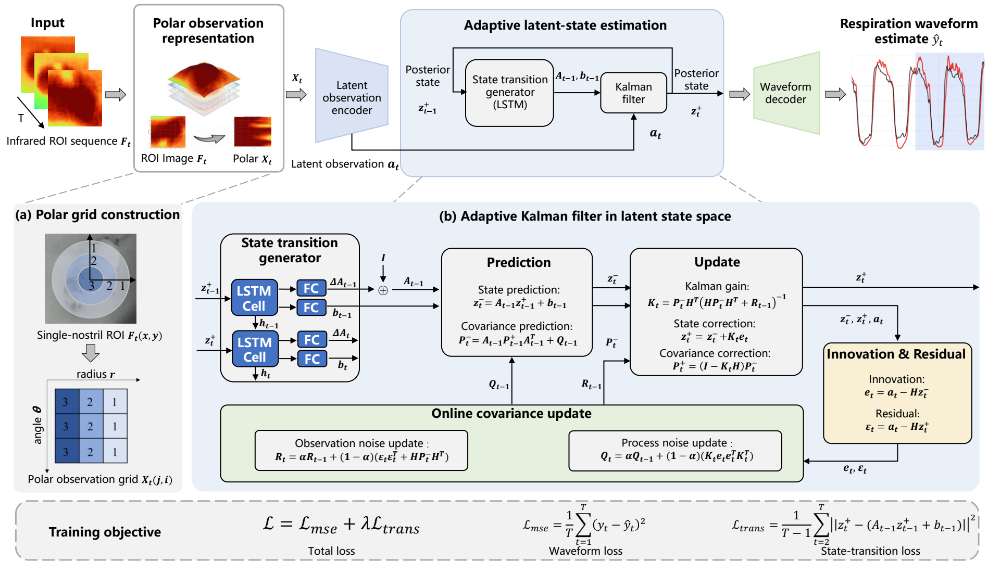
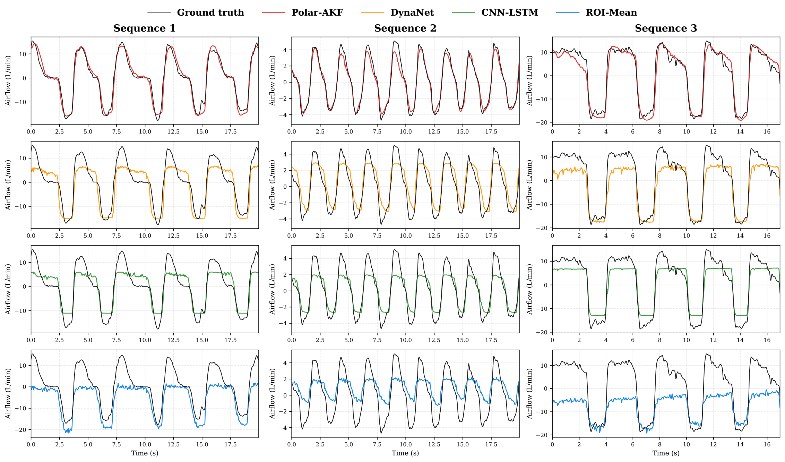

# Polar-AKF

## Abstract

Infrared image sequences capturing the temperature change caused by the respiration process make it possible to estimate continuous respiratory waveforms contactlessly in clinical applications. Existing direct video-to-waveform regression approaches fail to incorporate spatial temperature structural features and cannot explicitly model temporal state evolution as well as time-varying observation reliability. This work formulates the estimation of respiratory waveform from infrared image sequences as recursive state estimation in a latent state space. An end-to-end adaptive deep Kalman filtering framework (Polar-AKF) is then designed, which utilizes the nostril-centered polar observation grid as physical constraint observations, and proposes a linear state-transition loss function to regularize a continuous linear manifold based state space. The online covariance update method is further involved to address the temporal variation in both process and observation noise. The experimental results demonstrate that Polar-AKF achieved a root mean square error of 2.95, which is 22% lower than the widely utilized baseline method and up to 66% lower under infrared image sequences with Gaussian noise.

## Architecture

<p align="center">
  
</p>

## Main results

<p align="center">
  
</p>

## Requirements

Recommended GPU runtime environment:

- Python 3.10
- NVIDIA GPU with a driver compatible with CUDA 12.8
- PyTorch 2.7.1 with CUDA 12.8
- NumPy 2.2.6
- PyYAML 6.0.3

Install the runtime dependencies with:

```bash
pip install -r requirements.txt
```

The PyTorch wheel includes the required CUDA runtime libraries; a separate CUDA Toolkit installation is not required. A compatible NVIDIA driver is still required.

Verify that PyTorch can access the GPU:

```bash
python -c "import torch; print(torch.__version__); print(torch.cuda.is_available()); print(torch.cuda.get_device_name(0) if torch.cuda.is_available() else 'CUDA unavailable')"
```

The code can also fall back to CPU when `--device auto` is used and CUDA is unavailable.

## Project structure

```text
Polar-AKF/
├── configs/
│   └── polar_akf.yaml
├── data/
│   └── input/
├── figures/
│   ├── architecture.png
│   └── baseline_compare.png
├── network/
│   ├── checkpoint.py
│   ├── configuration.py
│   ├── decoder.py
│   ├── dynamics.py
│   ├── encoder.py
│   ├── filter.py
│   ├── frontend.py
│   └── polar_akf.py
├── results/
│   ├── checkpoints/
│   └── predictions/
├── test.py
├── LICENSE
└── requirements.txt
```

## Input and checkpoint

Prepare a preprocessed left-nostril sequence:

- Format: NumPy `.npy`
- Data type: `float32`
- Shape: `[192, 1, 112, 112]`

Place the input and compatible PyTorch `state_dict` at:

```text
data/input/prepared_left_nostril.npy
results/checkpoints/polar_akf.pt
```

The input must be cropped, aligned, resized, and standardized consistently with the model.

## Testing

With files placed at the default locations, run:

```bash
python test.py --device auto
```

The standardized waveform is saved to:

```text
./results/predictions/prediction.npy
```

Paths can be overridden explicitly:

```bash
python test.py \
  --input data/input/prepared_left_nostril.npy \
  --checkpoint results/checkpoints/polar_akf.pt \
  --config configs/polar_akf.yaml \
  --output results/predictions/prediction.npy \
  --device cuda
```

## Citation

Citation information will be added after the associated manuscript becomes publicly available.

## License

See `LICENSE` for the applicable terms. Third-party dependencies remain subject to their respective licenses.

